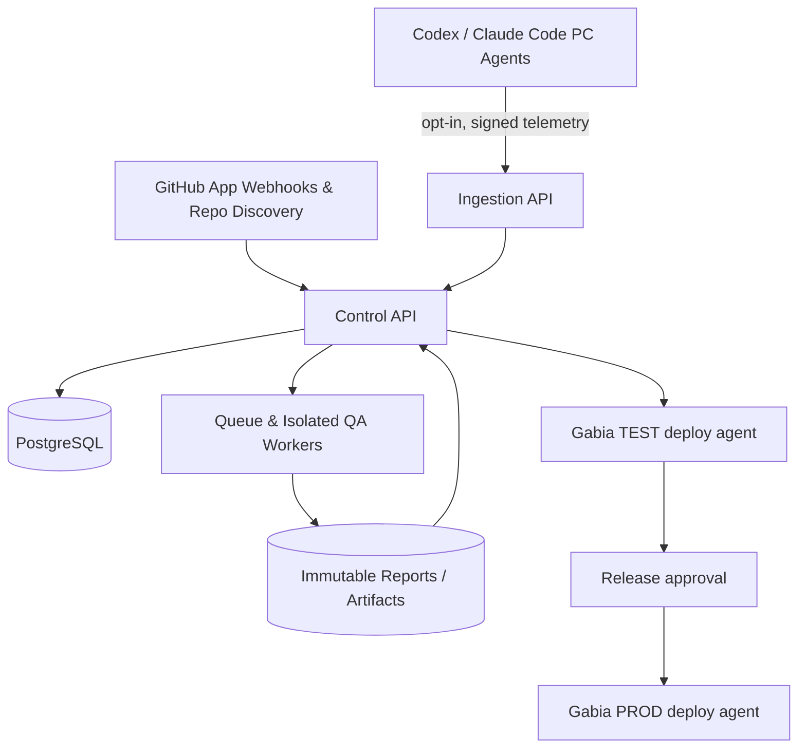

# VIBE CODE QA MASTER — 개발 명세 v0.1

## 1. 확정된 제품 범위

- 형태: 독립 웹 플랫폼. Webjux/ROOMAX/Gumi-axfactory 등 서로 다른 저장소를 선택적으로 연결.
- AI 실행: 기존 PC의 Codex/Claude Code를 옵트인 방식으로 관측하고, 차후 중앙 실행기를 통한 표준화된 작업 실행 병행.
- 품질: 보안, 기능, 성능, 리소스, 하드테스트 결과를 동일 커밋 SHA와 검사 환경에 귀속.
- 배포: 가비아 TEST와 PRODUCTION을 분리. 운영 배포는 품질 게이트와 관리자 승인 후 수행.
- **현재 구현: 관리 평면 MVP. 원격 코드 실행/서버 배포는 연결되지 않음.**

## 2. 아키텍처



### 서비스 분리 (운영 목표)

| 구성 | 책임 | 권한 |
|---|---|---|
| API / Web | 사용자 인증, RBAC, 프로젝트, 보고서 | 저장소 읽기, 메타데이터 |
| GitHub Connector | 설치 범위 내 저장소 동기화, Webhook 서명 검증 | Metadata/Contents read; 필요 시 Checks write |
| Device Collector | 명시적으로 등록한 PC의 실행 상태 이벤트 | 프로젝트별 수집 토큰 |
| QA Worker | 격리 컨테이너에서 타입/단위/E2E/SAST/DAST/k6 | TEST 리소스만 접근 |
| Execution Broker | 승인된 스킬/템플릿 기반 Codex/Claude 작업 실행 | 단기·최소 권한 토큰 |
| Gabia Deploy Agent | 서명된 릴리스 아티팩트 수신/검증, 롤백 | 환경별 한정 권한 |
| OTel/Monitoring | 구조화 실행 이벤트, CPU/RAM/디스크/오류 지표 | 민감정보 수집 금지 |

## 3. 프로젝트 동기화 및 승인

1. GitHub App을 특정 저장소에 선택적으로 설치한다.
2. installation/repository API로 저장소와 가시성, 최신 SHA, 언어, 기본 브랜치를 읽는다.
3. 신규 항목은 `pending`; 관리자만 `approved`로 전환 가능.
4. 승인된 저장소만 QA 정책 설치 요청·작업 큐 연결 대상으로 삼는다.
5. GitHub App 권한 변경/제거 시 토큰 만료 처리 및 동기화 중단.
6. 설치 범위 밖 저장소는 자동 조회도 변경도 하지 않는다.

실제 MVP는 환경 변수로 공급된 읽기 전용 GitHub 토큰을 사용한다. GitHub App OAuth 설치, webhook은 후속 구현.

## 4. 이벤트 계약

`POST /api/events` : Bearer `QA_AGENT_TOKEN`

```json
{"event_id":"uuid-or-unique-string","project_id":1,"provider":"codex","device":"pc-01","status":"started","timestamp":"2026-10-23T00:00:00Z","metadata":{"run_id":"opaque-id","phase":"analysis","duration_ms":120}}
```

- 실행 상태: `started → running | waiting → finished | failed`
- 이벤트 id로 중복 제거; 이벤트 순서는 timestamp와 서버 수신 순서를 모두 보존하도록 추후 강화.
- 스킬/훅 설치에 대한 사전 동의, 장치별 식별자·토큰 발급, 최소 권한, 토큰 폐기 기능 필요.
- 프롬프트, 코드 내용, 명령 출력, 인증정보를 기본 수집하지 않는다.
- Codex: SDK/App Server와 옵트인 OpenTelemetry; Claude Code: Hooks/OpenTelemetry를 공통 이벤트로 변환.
- UI에 표시하는 상태는 원본 AI 제공자가 보장한 범위를 넘어서 추론하지 않는다. 신호 미수신은 `unknown`으로 취급.

## 5. QA 정책과 릴리스 게이트

| 영역 | 기본 도구 후보 | 증거 |
|---|---|---|
| Security | Codex Security, Semgrep, pip-audit/npm audit, ZAP (격리 TEST) | SARIF, JSON, 취약점 목록 |
| Functional | pytest, Vitest/Jest, Playwright | JUnit XML, HTML trace |
| Performance | k6 | p50/p95/p99, 오류율, 처리량 |
| Resources | psutil / cAdvisor / Prometheus | CPU, RSS, 디스크, 네트워크 |
| Hard test | k6 soak/stress/spike, 장애 복구 시나리오 | 1h/24h 지표 및 복구 시간 |

모든 보고서에 `repository, commit_sha, build_id, policy_version, environment, started_at, ended_at, result, artifacts, evidence_hash`를 기록한다.

- 결과 상태는 `pass, fail, warning, not_run`; **미실행은 통과가 아니다.**
- 릴리스 정책: 기준 SHA의 모든 필수 검사가 PASS, 취약점 예외는 사유·만료일·승인자가 기록되어야 한다.
- 테스트 대상이 살아 있는 운영 호스트이면 고강도 부하·침투 검사 중단.
- QA Worker는 CPU/메모리/시간 제한이 있는 격리된 실행기로 운영한다.
- UI 기반 입력만으로 만든 PASS는 신뢰하지 않는다. 서명된 GitHub Actions 아티팩트 및 실행 주체와 대조해야 한다.

## 6. 가비아 TEST/PROD 분리

- 각 환경: 별도 애플리케이션, 데이터베이스, 객체/파일 저장, 환경 변수, 로그 보관, 권한, 백업.
- 동일한 빌드 아티팩트를 TEST에 설치 후 PRODUCTION으로 승격. 운영 서버에서 소스 재빌드 금지.
- TEST에는 합성 데이터만 사용. 운영 DB 덤프를 무단 복제하지 않는다.
- 운영 배포는 수동 승인 + 새 릴리스 점검 + 스냅샷/백업 + 헬스체크 + 롤백 절차.
- 단일 물리 서버 Docker 분리는 장애 도메인을 공유하므로 하드테스트 중 운영 격리 보장 불가. 2대 서버 분리를 권장.
- 실제 서버 타입/OS/리소스/SSH 및 TLS 설정 확인 전 원격 설치·방화벽 수정 금지.

## 7. 권한, 데이터 및 API

### MVP

- `GET /api/projects`, `POST /api/projects`, `POST /api/github/discover`
- `POST /api/projects/{id}/approve`
- `POST /api/events`, `GET /api/events`
- `POST /api/checks`, `GET /api/reports/{project_id}?revision=...`
- `POST /api/deployments`, `POST /api/deployments/{id}/approve`
- `GET /api/summary`, `GET /api/health`

### 운영 스키마 (추가 계획)

- organizations, users, roles, memberships
- github_installations, repositories, project_approvals
- devices, device_credentials, agent_sessions, agent_events
- qa_policies, qa_runs, qa_findings, qa_artifacts
- environments, releases, deployments, deployment_approvals
- audit_logs, alerts, secrets_references

보관 정책: 디바이스 이벤트 30~90일(설정), 감사 및 릴리스 보고서 1년 이상(정책 결정), 개인 정보는 최소화.

## 8. 개발 백로그

### M1 (현재 MVP)

- [x] API + SQLite 영속 저장 + 관리자 UI
- [x] 수동 프로젝트 승인, read-only GitHub 검색
- [x] AI 표준 이벤트 계약, 중복 방지와 프롬프트 제거
- [x] QA 보고서, 미실행 불합격, 배포 승인 상태
- [ ] 운영 인증/권한, 감사로그, PostgreSQL

### M2 (QA)

- [ ] GitHub App, webhook 서명 검증, 저장소별 설치 범위
- [ ] 분리된 QA 컨테이너 러너, 각 기술 스택 검사기
- [ ] SARIF/JUnit/k6 보고서 자동 수집 및 진위 검증
- [ ] SHA/환경별 기준과 실패 시 PR 체크

### M3 (AI 통합)

- [ ] Codex/Claude Code PC 훅 설치/해제와 장치 인증
- [ ] OTel 수집기, 이벤트 재전송, 상태 타임아웃
- [ ] 중앙 실행 브로커, 승인 큐, 비용 및 동시실행 제한

### M4 (Gabia)

- [ ] 보유 가비아 서버 사양/권한 확인
- [ ] TEST/PROD Docker 및 DB/스토리지 격리
- [ ] 암호화 백업/복원 검사, 배포/롤백 및 모니터링
- [ ] 장애 대응 런북과 운영 배포 체크리스트

## 9. 운영 전 필수 차단 항목

- 이 MVP의 공용 Bearer 토큰 방식은 실서비스용이 아님: TLS + SSO/MFA + RBAC + 토큰 회전 필요.
- 앱 DB를 SQLite에서 운영 PostgreSQL로 전환하고 영속 볼륨·백업 설정.
- 웹 UI에서 토큰은 메모리에서만 사용하고 영속 저장 금지.
- Github App 설치 시 작업 브랜치/PR 쓰기는 별도 권한·승인으로만 확대.
- 서버 실행 에이전트가 저장소 텍스트/AI 출력을 셸 명령으로 곧바로 실행하지 않도록 허용목록 사용.
